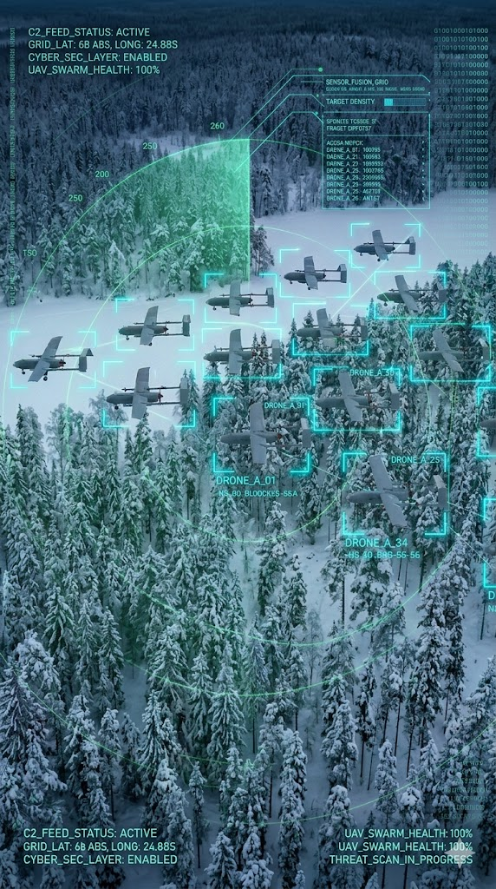

# DEFINE Edge Fusion Engine (Context Foundry)
<p align="center">
  
</p>

High-performance, format-agnostic Tactical Edge Sensor Fusion Gateway

The DEFINE Edge Fusion Engine is a modular tactical sensor fusion gateway designed for edge operations. It ingests heterogeneous sensor telemetry from radars, acoustic arrays, and EO/IR systems, performs real-time multi-sensor track fusion using advanced mathematical filtering, and delivers operationally relevant situational awareness directly to mission users and C2 systems.

## Core Capabilities

### Universal C2 Gateway Architecture

Format-agnostic architecture with decoupled ingestion, fusion, and dissemination pipelines, enabling rapid integration of new sensors, protocols, and C2 ecosystems.

### Dual-Mode Execution

Supports both:

- Scenario Replay (```--replay-file```) — analysis of recorded JSON-based sensor scenarios.
- Live Edge (```--enable-sapient``` / ```--enable-cot```) — real-time processing of tactical telemetry over UDP networks.

### Advanced Multi-Sensor Track Fusion

Built on the Stone Soup framework, leveraging:
- 9D Unscented Kalman Filters (UKF) for nonlinear state estimation.
- Global nearest-neighbour association over a Mahalanobis gate, solved as a 2D assignment, for multi-sensor track correlation.
- Persistent tracking of dynamic targets, including UAV and swarm scenarios.

Association cost is polynomial in tracks × detections, and every term of one fusion pass is bounded — the live track population, the detections one event may carry, and how long a track may coast. That matters at density: exact joint association is exponential once coasting tracks' gates overlap into a single cluster, which at 9 nodes and 80 objects meant one call that never returned and allocated 9.8 GiB.

<br clear="right"/>

### Multi-Format Sensor Ingestion

Supports validated tactical data flows including:
- BSI Flex 335 SAPIENT JSON telemetry for replay and simulation.
- SAPIENT Protobuf streams for live low-latency operation.

### Tactical Track Augmentation & Dissemination

Transforms sensor data into operational tracks by:
- Converting kinematic vectors into WGS84 geospatial coordinates.
- Adding contextual metadata. A track's swarm count is the largest any of its detections gave within the last 60 s, since sensors see one swarm differently (one counts the swarm, another each drone, a CoT event nothing), and a track judged hostile stays hostile for 60 s, so neither flickers between updates.
- Judging each fused track's threat. The rule: faster than 20 m/s or a swarm of more than 3 is `hostile`, held for 60 s after the last time the track was judged so, anything else `suspect`. What the track's hits within the last 60 s agree it is tempers the rule. A sensor's class says what a hit is only when its top level has a confidence of 0.5 or more, read without a namespace prefix such as `sapient_core:` or case; a sensor unsure of an object, listing every class at a low confidence, says nothing. Another party's CoT report says it by its type's dimension: `G` is ground, any other dimension, sea surface `S` included, something else; a self-report says nothing here, its declaration speaks for it. When every hit that says what the track is says an animal (an `Animal` or `Bird` class at any level), the track is neither fast nor a swarm to the rule and any hostile hold on it ends, unless it goes faster than 35 m/s, faster than any bird, when it may be a drone classed wrongly and the rule judges it as any other. When every such hit says ground (a `Land vehicle` or `Human` top class, or a `G` dimension), speed does not make the track hostile; a swarm still does. A boat is not ground: fast attack boats travel alone, so speed still marks a boat hostile. One confident hit of anything else within the 60 s, a drone among them, leaves the rule to judge the track as before. A CoT object reporting its own position declares its affiliation, the letter after `a-` in its type: `f` and `a` are `friend`, `h` and `k` (faker) are `hostile`, `s` and `j` (joker) are `suspect`, `n` is `neutral`; `u`, `p`, `o` and `x` declare none. Only a self-report declares: an event whose `how` is `m-g` (from GPS), `m-f` (fused), `m-i` (surveyed, as an emplaced sensor reports itself) or `h-e` (entered by its user, as ATAK reports itself without a GPS fix), or a dash refinement of one such as `m-g-l`, from a uid whose reports the track takes. A relayed (`m-r`), predicted (`m-p`), simulated (`m-s`) or hand-placed (`h-g-i-g-o`) position, or any other `how`, declares nothing. The `how` is taken at its word: any CoT event carrying one of those values counts as a self-report, so a feed that labels other objects `m-g`, such as another system's radar tracks relayed as CoT, has each of them treated as an object reporting itself, with the affiliation its type gives. A uid that reports itself is an object of its own, however close to others: a track bound to it takes no CoT event of another uid, whether a self-report, a relay or a marker someone placed, by its uid or by its position, and a self-report never joins a track that took another uid's CoT event within the coast time (45 s by default); either continues or starts its own uid's track. Other parties' reports under different uids may share a track, as a C2 relaying one object under a uid it re-initiates, a new uid per report, or two relays of one object do. A uid that is not reporting itself holds the track it was fused into only until it has been silent for the coast time; its next event is then associated by position like a new one's, so a run and a rebuild from a later start fuse it alike. Only a self-report moves a self-reporting uid to another track; another party's report of the uid, such as a relay, leaves the uid's binding and declaration where they are. Sensor detections still join any track. A self-report is no stray report, so a track is confirmed, and published, from the first self-report it takes, whatever the confirmation setting (`--confirm-hits`, a pipeline stage's `confirm_hits`: that many reports within 30 s); every other track, one started by a SAPIENT detection or a CoT event that is not a self-report, still needs that many reports in time. Such tracks count against the live-track limit like any other, so a flood of self-reports from new uids fills it at once and the tracks after it are refused. An `m-i` self-report holds its track still: no velocity, and almost no process noise, so its gate stays about the size of the report's own error for as long as the track lives and an object passing by cannot take it over. Any other self-report that gives its own speed (the CoT detail's `track` `speed`) below 1 m/s holds its track as standing: no faster, and its velocity no more uncertain, than a walking pace, without acceleration and with little process noise, so between reports a minute or two apart its gate stays a few hundred metres wide rather than growing to kilometres and taking in other objects' sensor plots. The speed is believed only while the positions agree: a report further from where the current run of standing reports began than its declaration radius plus 1 m/s for every second since is of an object moving, whatever speed it gives, and ends the run. A self-report that misses its own track's gate is gated once more from where its previous report left the track, as if its speed were unknown, and a standing track whose uid now reports itself moving is gated and updated only so, so a phone that drives off, or one that gives a wrong speed, keeps its track without overshooting. A track's declaration is its uid's latest self-report, fresh until that event's own `stale`, but at least 60 s and at most 600 s after its event time, and 60 s when it has no readable `stale`. It stands only while the track is within 3 times the report's own horizontal error (its `ce`, 50 m when unknown), and never less than 50 m, of where the report placed it carried on at the velocity the track had then; a track further off is judged by the rule. So a vehicle keeps its mark between its reports, while an object that takes over the track of one standing still, or that leaves the way it was going, does not; the first report of a new track gives no velocity, so until its second one the mark stands only near where it was made. It leaves the track when the uid's self-reports move to another one. Once a uid's declaration is no longer fresh the uid is released from its track: the track stays, judged by the rule, unless the track of another uid that began reporting itself only after the first uid's last self-report lies inside its gate; then it is dropped, as the same object now reporting under the other uid, so what sensors see of it goes to that uid's track and a rebuild that never saw the first uid ends the same. A uid reporting all along beside it, such as another vehicle in a convoy, leaves it be. Without a declaration that stands the rule decides. A declared `hostile` is held for 60 s like the rule's. A declared `friend`, `neutral` or `suspect` stands unless the track took a hit from a sensor other than CoT within the last 60 s and its swarm count is more than 3, now or at any time within the last 60 s; then it is `hostile`. Speed never overrules a declaration: a friendly vehicle reporting itself stays `friend` however fast it goes, also when a radar plots it near its latest report, while a friendly report on a swarm a sensor keeps seeing does not make it `friend`. A declaration never ends a hold, so once none stands a hold still running shows again. A track written as CoT takes its dimension from the declaration that stands (`a-f-G-U-C` is drawn as `a-f-G`) and is otherwise, a declaration a swarm overrules included, drawn as air, `A-M-F`.
- Fusing only objects. A CoT event whose type does not begin `a-` (a map marker `b-*`, a tasking `t-*`, and the like) makes no detection, and neither does a cot-raw record that is `sapient-to-cot`'s rendering of a SAPIENT report, which fusion reads as SAPIENT itself. `context_foundry.fusion.cot_input.skip_reason(record)` says which of the two a cot-raw record is, `"not_object"` or `"rendering"`, or None for one fusion reads.
- Naming each fused track's sensors. A track written as a sapient-raw record (a SAPIENT `DetectionReport` from the fusion node) lists, as `associated_detection`, every sensor report it took since its previous record, the one that started it included: one entry per sensor `node_id` and sensor `object_id`, at the time its newest report gave, before a live event is clamped to the present, oldest first. A record standing for several updates within the publish window names the sensors behind all of them; a track's earlier sources are in its earlier records. A CoT event has no SAPIENT identity, so a CoT source is named by identifiers derived from it: its `node_id` is `uuid5(NAMESPACE_URL, "context-foundry-cot")`, `6e6451cd-0445-5b64-8388-063eab5f2acf`, the same for every CoT source, and its `object_id` is `uuid5(NAMESPACE_URL, "context-foundry-cot:<uid>")` written as a 26-character Crockford base32 ULID, the same on every report of that `uid`. `context_foundry.fusion.sapient_raw.cot_node_id()` and `cot_object_ulid(uid)` compute them, so a consumer holding a CoT `uid` can find the tracks it fed.
- Carrying each fused track's confidences. A track written as a sapient-raw record carries the `detection_confidence` and the classification confidences of the latest SAPIENT report associated with it: `confidence` on the top classification and on each `sub_class` level where that report gave one, on the first entry of each level as the class path follows. A report without them leaves the track without them; nothing is combined across reports. A confidence that is not a number in [0, 1] is left out, the report kept; a track labelled by a CoT event's type, because its SAPIENT reports gave none, carries no class confidences.
- Delivering standardized Cursor-on-Target (CoT) XML to a TAK Server — over the WebTAK streaming WebSocket (bearer-authenticated; tracks tagged with the producer's Keycloak groups) or a raw TCP+TLS stream — for dissemination to connected WebTAK/ATAK/WinTAK clients, or writing it to file for offline validation.

### Edge-Native Integration

Designed for distributed tactical environments, enabling low-latency sensor-to-user information flow across heterogeneous systems.

## Architecture

The system operates on a "Rosetta Stone" methodology. Incoming data is immediately mapped to a pure mathematical state space, tracked, and then serialized back out to whatever format the downstream consumer requires.

```text
[ ASMs / Sensors ]         [ The Core Engine ]          [ C2 Consumers ]
                                                                 
SAPIENT (JSON)   ──┐   ┌──> Pydantic Validation ──┐   ┌──> Cursor on Target → TAK (WS / TLS)
                   ├───┤                          ├───┤
SAPIENT (Binary) ──┘   └──> Stone Soup Tracker  ──┘   └──> SAPIENT (HLDMM)
                            (UKF + GNN)
```

## Quick Start

Because all SAPIENT standard .proto files are pre-vendored and compiled within the repository, the engine is fully capable of being built and deployed on secure, air-gapped tactical edge nodes.

### 1. Installation
Clone the repository and install the package in editable mode. This automatically configures your environment and registers the global Command Line Interface (CLI).

```bash
git clone https://github.com/define-ai-foundry/context-foundry.git
cd context-foundry

# Create and activate a virtual environment (Recommended)
python -m venv .venv
source .venv/bin/activate  # On Windows use: .venv\Scripts\activate

# Install the package and CLI
pip install -e .
```

### 2. Verify with Replay Mode
Test the math engine and tracking logic by replaying a validated scenario file. `--log-to-file` writes the fused CoT to `fused_tracks_debug.xml` for offline inspection — no network required.

By default a replay is paced to the scenario's own clock (`--realtime-factor 1.0`), so `data/examples/sapient_messages.json` (37.8 minutes of scenario time) takes 37.8 minutes to drain. Use `--realtime-factor N` to run N times faster (`5` replays a 38-minute scenario in ~7.6 minutes), or `--realtime-factor 0` to disable pacing and drain the file as fast as it can be fused — the fast path for offline math validation:

```bash
context-foundry-fusion --replay-file data/examples/sapient_messages.json --config config/sensors/joensuu.json --log-to-file --realtime-factor 0
```

Replayed events are stamped so the scenario **starts now**, keeping the original spacing between them. A recorded file therefore surfaces as if it were happening live, which is what consumers assume — TAK will not draw a marker for an event dated months away from the present. This is independent of `--realtime-factor`: the factor changes how fast events are emitted, never what they are stamped with. Pass `--use-scenario-timestamps` to emit the file's own clock instead, e.g. when comparing output against a recorded run.

`--cot-stale-seconds` (default `15`) sets how long a CoT marker stays live in TAK after the event it was built from. Raise it above the interval between a track's updates, or each marker expires just before its own next update and flickers on the map.

A finite replay exits once drained. Add `--loop` to restart it continuously (waiting `--loop-delay` seconds, default `60`, between iterations), turning a one-shot scenario into a long-running feed — ideal as a persistent Deployment demo streaming into TAK. Each iteration re-stamps the scenario to the new present, and starts a fresh tracker: a restart is a new scenario rather than a continuation, and under `--use-scenario-timestamps` the timestamps jump backwards, which Stone Soup cannot predict through. `--loop` only applies with `--replay-file`; live sources never terminate.

```bash
context-foundry-fusion --replay-file data/examples/sapient_messages.json --config config/sensors/joensuu.json --log-to-file --loop --loop-delay 30
```

## Running in a Container

The engine ships a container image and a `make`-driven dev loop that works with **Docker or Podman** (auto-detected; override with `make ENGINE=podman …`).

```bash
make build     # build the runtime + dev images
make demo      # replay the example scenario, log fused CoT, clean exit
make test      # run the suite in-container (matches CI, 95% coverage gate)
make lint      # ruff check + format --check in-container
make shell     # shell into the dev image with the worktree mounted
```

`make test`/`make lint` bind-mount the live worktree, so edits need no rebuild. `make demo` runs the **baked** runtime image — re-run `make build` after changing `src/`.

### Validate against a real TAK Server + WebTAK (per-group isolation)

A `tak` compose profile stands up a real `pvarki/tak-server` + PostGIS locally and demonstrates the group-correct path: two groups, each with its own producer, tracks visible **only** to that group's WebTAK users.

```bash
make tak-up      # start TAK Server + Postgres (first boot ~2–3 min)
make tak-users   # create one File user per group: 'alpha' (group alpha), 'bravo' (group bravo)
make tak-demo                        # replay into group 'alpha' over the WebTAK WebSocket sink
make tak-demo TAK_DEMO_GROUP=bravo   # ...or into group 'bravo'
make tak-demo TAK_DEMO_FACTOR=10     # ...at 10x real time (~4 min instead of ~38)
make tak-down    # stop (keeps volumes);  make tak-clean wipes them
```

`make tak-demo` fetches a TAK `/oauth/token` bearer for that group's File user and runs `TakWsSink` against `wss://…:8446/takproto/1`, so the CoT is tagged with the user's single TAK group. It streams at scenario cadence (~38 min for the example scenario) and holds the terminal until drained — raise `TAK_DEMO_FACTOR` to compress it. Log into `https://localhost:8446` as `alpha` / `Fusion-Demo-2026!` — with the map open **before** you run `make tak-demo` (TAK does not backfill history to a viewer that connects after the stream) — and you will see the tracks; log in as `bravo` and you will not. This mirrors the production model (one producer per group), using TAK File-user tokens locally in place of Keycloak; the Keycloak-token equivalent has been verified against a real TAK + Keycloak cluster. A raw TCP+TLS sink is also available (`make tls-demo`).

### Validate live ingestion (UDP sensor traffic, no file)

The demos above replay a file. `make live-demo` exercises the other mode: the engine reads sensor traffic **off the network** (`--enable-sapient` on UDP 5000, `--enable-cot` on UDP 6969) and streams the fused result into the same per-group WebTAK sink. `dev/udp_feeder.py` stands in for the ASMs — it replays `data/examples/sapient_messages.json` onto those sockets as either binary SAPIENT protobuf or CoT XML, stamped with the present at the moment of sending — one stamp per sweep, since a node that sees five objects at once reports all five with the same timestamp.

```bash
make tak-up && make tak-users            # once, as above
make tak-tail &                          # watch what group 'alpha' receives (start it first)
make live-demo                           # SAPIENT protobuf over UDP, at scenario cadence (~38 min)
make live-demo LIVE_PROTOCOL=cot         # ...CoT XML instead
make live-demo LIVE_FACTOR=10            # ...10x faster: an ingest smoke test, see below
make tak-tail TAK_DEMO_GROUP=bravo       # confirm 'bravo' receives none (during a feed)
make live-down                           # stop the engine (leaves TAK up)
```

`make live-demo` starts the engine detached and runs the feeder in the foreground, so the run lasts as long as the feed. Both live sources are read concurrently, so `--enable-sapient --enable-cot` together work: each source gets its own reader thread, and events are fused in arrival order. An event whose timestamp is **out of step with the rest** is dropped: the tracker cannot predict backwards, so letting a late one through rewinds *every* track's timestamp and redraws its TAK marker in the past. Events are therefore gated to the newest timestamp seen — and a live event stamped more than ten seconds **ahead of the present** is refused that mark, or one bad clock (or one spoofed datagram) would set a watermark every healthy sensor then falls behind, silencing the engine for good. Drops are re-reported once a minute with a running count and the node id involved, rather than once per run. **Keep the sensors' clocks in step.** If fusion falls behind the incoming rate the readers stall rather than discard, so nothing is lost in-process; sustained overload then overruns the kernel's socket receive buffer (visible as the drop counter for the socket in `/proc/net/udp`).

A live socket sees one datagram at a time, but a sensor that reports five objects at one instant sends five of them, and the fused result depends on that instant arriving as **one event** — the contract a replay file's grouping gives for free, and what the associator needs in order to match more than one detection per track update. The engine therefore assembles the datagrams of one sensor-instant into a single event, bounded by a short window (`--frame-window-seconds`, 250 ms) from the instant's first datagram: every live detection pays at least that window in latency — a frame surfaces on the first read that returns after it expires, so a slow consumer adds to it — and a sweep whose datagrams are spread wider than the window splits across events. Several sensors' frames are assembled independently and in parallel, so two nodes whose sweeps overlap interleave on the wire without either losing detections, and each is handed on when its own window is up, in the order the datagrams arrived.

The window bounds a sweep's **arrival spread**, which is why 250 ms is enough for sweeps that a sensor emits as a burst: measured at 9 nodes × 80 objects, every sweep arrived whole with no splits and nothing discarded, while one fusion pass took 0.44 s. A pass that overlaps a frame still being assembled can split it, so if the per-event log line starts reporting partial sweeps, raise the window. The two things worth watching in the summary are that and the kernel discard counter.

A replay file and a live source cannot be combined — the engine refuses the pair. A scenario runs on its own clock, minutes or hours away from the sensors', and the gate above would silently discard whichever is behind.

Because the feeder stamps at send time, `LIVE_FACTOR` compresses the timeline the engine sees rather than pushing timestamps into the future — the same targets appear to move that many times faster. **Fusion does not survive that.** The tracker's association gate is sized by the interval between events, so a compressed feed makes it too tight to match anything and every detection starts its own track: the scenario's first 40 detections fuse into 16 tracks at `LIVE_FACTOR=1` and 40 — one per detection, i.e. no association at all — at `LIVE_FACTOR=10`. Use a factor above 1 to check that ingest works, and 1 (the default) to judge the fused picture. (16 tracks for those 40 detections is itself more than the objects behind them; association quality on the scenario is a separate, pre-existing matter.) The engine's own `--replay-file` pacing has no such limit: it compresses emission while keeping the scenario's spacing, which is exactly what a replay can do and a live sensor cannot.

The feeder's CoT mode emits a fixed hostile type for every track, so every track it feeds is declared hostile, and carries no classification or swarm count (a CoT `<event>` has nowhere standard to put them), so `LIVE_PROTOCOL=cot` exercises the ingest path, not the classification carry-through that SAPIENT reports drive.

`make tak-tail` is the scriptable stand-in for a WebTAK browser session: it subscribes to `wss://…:8446/takproto/1` as a group's File user and prints the CoT that user is allowed to see. Run it (or open WebTAK) **before** the feed starts — TAK does not backfill to a late subscriber. Receiving nothing is the expected result for a group the producer is not in, so the target says so rather than failing; `dev/webtak_ws_tail.py` itself exits non-zero on an empty tail, for a script that wants to assert delivery.

Run the feeder against a non-containerised engine the same way:

```bash
context-foundry-fusion --enable-sapient --config config/sensors/joensuu.json --log-to-file &
python dev/udp_feeder.py --protocol sapient --realtime-factor 10
```

A live run only ends when it is signalled; SIGTERM (`docker stop`, a pod deletion) closes the sinks and exits.

## CLI Reference

The installation exposes the `context-foundry-fusion` command globally. `--config` names the sensor network file; with `--kafka-topic` it is optional, since each sensor's kind, accuracy, range and position are then learned from its SAPIENT Registration and status reports, and what a sensor declares wins over the file. At least one source (`--replay-file`, `--enable-sapient`, or `--enable-cot`) must be provided. `--replay-file` and the live sources are **mutually exclusive** — a scenario's clock does not line up with a sensor's, and the engine refuses the pair rather than silently discarding whichever is behind. The two live sources can be used together, provided their sensors agree on the time. At least one output sink is also required — `--log-to-file`, `--tak-ws-host`, `--tak-tls-host`, or any combination.

| Flag / Argument | Type | Description | Default / Required |
| :--- | :--- | :--- | :--- |
| `--config` | `String` | Path to the sensor network config JSON. Optional with `--kafka-topic`: sensors are learned from their Registration and status reports. | `None` |
| `--replay-file` | `String` | Path to a JSON scenario file to replay. Cannot be combined with a live source. | *One source required* |
| `--loop` | `Flag` | With `--replay-file`, restart the replay continuously instead of exiting — turns a one-shot replay into a continuous feed (ideal as a long-running Deployment demo streaming into TAK). No effect without `--replay-file`. | `False` |
| `--loop-delay` | `Float` | Seconds to wait between replay iterations when `--loop` is set. | `60` |
| `--realtime-factor` | `Float` | With `--replay-file`, the speed to emit events at relative to the scenario's own timeline: `1.0` replays at real time, `5` replays five times faster, `0` disables pacing and drains as fast as events can be fused. No effect without `--replay-file`. Must be `>= 0`. | `1.0` |
| `--use-scenario-timestamps` | `Flag` | With `--replay-file`, stamp events with the timestamps in the file instead of shifting the scenario to start now. TAK may treat the result as too old or too far ahead to display. No effect without `--replay-file`. | `False` |
| `--cot-stale-seconds` | `Float` | How long a CoT marker stays live in TAK after the event it was built from. | `15` |
| `--enable-sapient` | `Flag` | Enable the live SAPIENT UDP stream (port 5000). Cannot be combined with `--replay-file`. | `False` |
| `--enable-cot` | `Flag` | Enable the live CoT UDP stream (port 6969). Cannot be combined with `--replay-file`. | `False` |
| `--log-to-file` | `Flag` | Write fused CoT to `fused_tracks_debug.xml` for offline validation. | *One sink required* |
| `--tak-ws-host` | `String` | TAK host for the WebTAK WebSocket sink (bearer-auth; CoT tagged with the token's Keycloak groups). Enables the sink. | *One sink required* |
| `--tak-ws-port` | `Integer` | WebTAK WebSocket port. | `8446` |
| `--keycloak-token-url` | `String` | Keycloak token endpoint for the `client_credentials` grant. | *WS: unless `--tak-bearer-token`* |
| `--oidc-client-id` | `String` | Keycloak client id — the producer identity, whose group its CoT lands in. | *WS: with token URL* |
| `--oidc-client-secret` | `String` | Keycloak client secret (confidential client). | *Optional* |
| `--tak-bearer-token` | `String` | Static bearer token, as an alternative to a Keycloak grant. | *Optional* |
| `--tak-ws-verify-tls` | `Flag` | Verify the TAK server against the system trust store. A server dialled by a name its certificate does not carry — an in-cluster Service name — fails here; use `--tak-ws-ca`. Never affects the Keycloak token exchange, which is always verified. | `False` |
| `--tak-ws-ca` | `String` | CA bundle (PEM) verifying the TAK server on the WebSocket sink. The production trust setting; takes precedence over `--tak-ws-verify-tls`. | *Optional* |
| `--tak-ws-token-timeout` | `Float` | Seconds to wait on the Keycloak token endpoint. The fetch blocks the fusion loop, so the sensor sockets go unread for its duration. | `5` |
| `--frame-window-seconds` | `Float` | How long a live source holds one sensor-instant open to collect the rest of its datagrams before handing it on as one event. Must exceed both the spread of a sweep's datagrams and one fusion pass, or sweeps split into single-detection events. Costs that much latency per live detection. | `0.25` |
| `--max-live-tracks` | `Integer` | Live tracks held at once. Detections that associate with nothing each start a track, so clutter or an injected feed grow the population; past this bound new tracks are refused and reported, which keeps the targets already being followed. | `120` |
| `--max-track-history` | `Integer` | States retained per track. Nothing downstream reads history; it is history times the track bound that has to fit the memory limit. | `20` |
| `--max-event-detections` | `Integer` | Largest number of detections one event carries into association — the only cost term a sender controls. Past it detections are shed in a deterministic order and reported. | `300` |
| `--max-coast-seconds` | `Float` | How long a track may coast without a real detection before it is dropped. Must exceed the interval at which a target is re-detected, or tracks die between revisits (on the reference scenario, `20` gives 274 tracks against 88 at the default). A track past it is dropped before the next detections are matched, so it cannot absorb another object. | `45` |
| `--tak-tls-host` | `String` | TAK host to stream CoT to over raw TCP+TLS (port 8089); enables the TLS sink. | *One sink required* |
| `--tak-tls-port` | `Integer` | TAK TLS port. | `8089` |
| `--tak-tls-cert` | `String` | Client certificate (PEM) for mutual TLS. | *Optional* |
| `--tak-tls-key` | `String` | Client private key (PEM). | *Optional* |
| `--tak-tls-ca` | `String` | CA bundle (PEM) used to verify the TAK Server. | *Optional* |

### Delivering CoT to a TAK Server

TAK only shows a track to viewers who share a **group** with it, so the choice of sink is really a choice of how the producer's group is assigned:

- **WebTAK WebSocket + Keycloak (`--tak-ws-host`, recommended).** The producer authenticates to `wss://<host>:8446/takproto/1` with a Keycloak bearer (a `client_credentials` grant via `--keycloak-token-url`/`--oidc-client-id`/`--oidc-client-secret`, or a static `--tak-bearer-token`). **CoT is tagged with the token's Keycloak `groups`** — so run **one producer per group** with a Keycloak identity in that single group, and only that group's WebTAK users see its tracks. No client certificate. This is the group-correct path for a multi-tenant TAK, verified end-to-end against a real TAK + Keycloak cluster.

  ```bash
  context-foundry-fusion --replay-file data/examples/sapient_messages.json \
    --config config/sensors/joensuu.json \
    --tak-ws-host tak.example.mil \
    --keycloak-token-url https://iam.example.mil/realms/rain-realm/protocol/openid-connect/token \
    --oidc-client-id cf-team-viper --oidc-client-secret "$CF_CLIENT_SECRET"
  ```

- **Raw TCP+TLS stream (`--tak-tls-host`).** Streams newline-delimited CoT to the TAK `stdssl` input (port 8089). With `authRequired="true"` it is mutual TLS — supply a CA-signed client cert (`--tak-tls-cert`/`--tak-tls-key`) and the CA bundle (`--tak-tls-ca`); omitting `--tak-tls-ca` skips server verification (local/self-signed only). **Group assignment is server-side, not from the cert's OU** — TAK's `x509groups` OU→group mapping does not work on the stock pvarki image, so the group comes from a `<filtergroup>` on the input or from registering the cert as a group user (`certmod -g`, which requires a messaging restart).

  ```bash
  context-foundry-fusion --enable-sapient --config config/sensors/joensuu.json \
    --tak-tls-host tak.example.mil --tak-tls-cert client.pem --tak-tls-key client.key --tak-tls-ca ca.pem
  ```

## Repository Structure

```text
context-foundry/
├─ config/
│  ├─ sensors/
│  │  └─ joensuu.json
│  └─ locations.yaml
├─ data/
│  ├─ examples/
│  │  └─ sapient_messages.json
│  └─ generated_input/
│     └─ joensuu_messages.json
├─ docs/
│  ├─ 01-concepts/
│  └─ 02-architecture/
├─ protos/
│  ├─ cot/
│  │  ├─ CoT Base-Event Schema  (PUBLIC RELEASE).xsd
│  │  ├─ CoT Contact Schema (PUBLIC RELEASE).xsd
│  │  ├─ CoT Flow-Tags Schema  (PUBLIC RELEASE).xsd
│  │  ├─ CoT Image Schema  (PUBLIC RELEASE).xsd
│  │  ├─ CoT Link Schema  (PUBLIC RELEASE).xsd
│  │  ├─ CoT Remarks Schema  (PUBLIC RELEASE).xsd
│  │  ├─ CoT Request Schema  (PUBLIC RELEASE).xsd
│  │  ├─ CoT Sensor Schema  (PUBLIC RELEASE).xsd
│  │  ├─ CoT Shape Schema  (PUBLIC RELEASE).xsd
│  │  ├─ CoT Spatial Schema  (PUBLIC RELEASE).xsd
│  │  ├─ CoT Track Schema  (PUBLIC RELEASE).xsd
│  │  └─ CoT Uid Schema  (PUBLIC RELEASE).xsd
│  └─ sapient_msg/
│     ├─ bsi_flex_335_v2_0/
│     │  ├─ alert_ack.proto
│     │  ├─ alert.proto
│     │  ├─ associated_detection.proto
│     │  ├─ associated_file.proto
│     │  ├─ detection_report.proto
│     │  ├─ error.proto
│     │  ├─ follow.proto
│     │  ├─ location.proto
│     │  ├─ range_bearing.proto
│     │  ├─ registration_ack.proto
│     │  ├─ registration.proto
│     │  ├─ sapient_message.proto
│     │  ├─ status_report.proto
│     │  ├─ task_ack.proto
│     │  ├─ task.proto
│     │  └─ velocity.proto
│     └─ proto_options.proto
├─ src/
│  ├─ context_foundry/
│  │  ├─ fusion/
│  │  │  ├─ sources/
│  │  │  │  ├─ base.py
│  │  │  │  ├─ cot_stream.py
│  │  │  │  ├─ json_file.py
│  │  │  │  ├─ multiplex.py
│  │  │  │  ├─ offset.py
│  │  │  │  ├─ paced.py
│  │  │  │  └─ stream.py
│  │  │  ├─ validators/
│  │  │  │  ├─ base.py
│  │  │  │  ├─ cot.py
│  │  │  │  └─ sapient.py
│  │  │  ├─ sinks/
│  │  │  │  ├─ base.py
│  │  │  │  ├─ file.py
│  │  │  │  ├─ tak_tls.py
│  │  │  │  └─ tak_ws.py
│  │  │  ├─ augmentor.py
│  │  │  ├─ config.py
│  │  │  ├─ models.py
│  │  │  ├─ schemas.py
│  │  │  ├─ serializers.py
│  │  │  ├─ timeutil.py
│  │  │  └─ tracker.py
│  │  └─ cli.py
│  └─ sapient_msg/
│     └─ bsi_flex_335_v2_0/
│        ├─ alert_ack_pb2.py
│        ├─ alert_pb2.py
│        ├─ associated_detection_pb2.py
│        ├─ associated_file_pb2.py
│        ├─ detection_report_pb2.py
│        ├─ error_pb2.py
│        ├─ follow_pb2.py
│        ├─ location_pb2.py
│        ├─ range_bearing_pb2.py
│        ├─ registration_ack_pb2.py
│        ├─ registration_pb2.py
│        ├─ sapient_message_pb2.py
│        ├─ status_report_pb2.py
│        ├─ task_ack_pb2.py
│        ├─ task_pb2.py
│        └─ velocity_pb2.py
├─ tests/
├─ .github/
│  └─ workflows/
│     └─ ci.yml
├─ Dockerfile
├─ .dockerignore
├─ compose.yaml
├─ Makefile
├─ dev/                    # UDP sensor feeder, WebTAK tail, TLS listener, real-TAK helpers (certs gitignored)
├─ compile_protos.sh
├─ winter_swarm_header.jpg
├─ LICENSE
├─ pyproject.toml
└─ README.md
```

## Extending the Gateway

Due to the format-agnostic core, adding support for new networks (e.g., Link 16, ASTERIX) is incredibly simple:

- Create a new class extending ```BaseSerializer``` inside ```src/context_foundry/fusion/serializers.py.```

- Map the universal ```TacticalState``` parameters (e.g., ```state.lat, state.speed_m_s```) to your target format.

- Register your new serializer in the ```cli.py``` routing dictionary. The tracker logic remains completely untouched!

## Development

Install the project together with the development tooling (Ruff, pytest, pytest-cov):

```bash
pip install -e ".[dev]"
```

### Linting

Linting and formatting use [Ruff](https://docs.astral.sh/ruff/). Its configuration lives in `pyproject.toml`:

```bash
ruff check .           # report lint issues
ruff format --check .  # report formatting issues

ruff check --fix .     # auto-fix lint issues
ruff format .          # apply formatting
```

### Testing

Tests use `pytest` with branch coverage via `pytest-cov`. The coverage settings and the 95% minimum gate are configured in `pyproject.toml`, so a plain invocation runs the full suite and prints a coverage report:

```bash
pytest
```

The run fails if coverage drops below the configured threshold. Tests never touch the network or `data/**` — all fixtures are synthesized.

### Continuous Integration

All of the above run automatically on GitHub Actions (`.github/workflows/ci.yml`) for every push to `main`/`master` and every pull request: Ruff lint, Ruff format check, and the test suite with the coverage gate.


### Releases

This engine is not released on its own: its version stays `0.1.0` and nothing is published from here. [pipeline-stages](https://github.com/define-ai-foundry/pipeline-stages) consumes it as a commit tarball pinned in its `fusion` extra, so a change here reaches a deployed pipeline only through a pipeline-stages release; see its README.

Copyright 2026 Lempea Edge Oy / DEFINE AI Foundry. SPDX-License-Identifier: Apache-2.0
